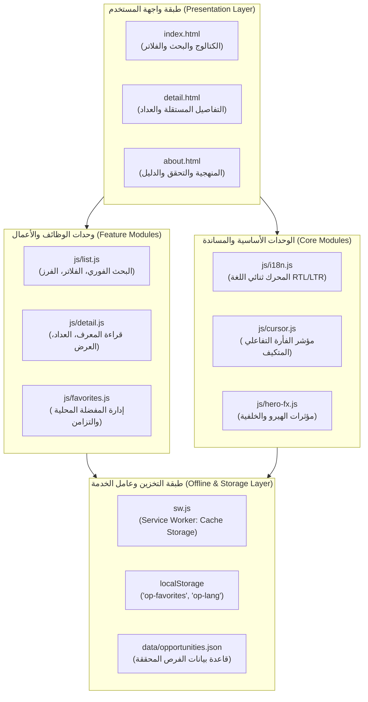
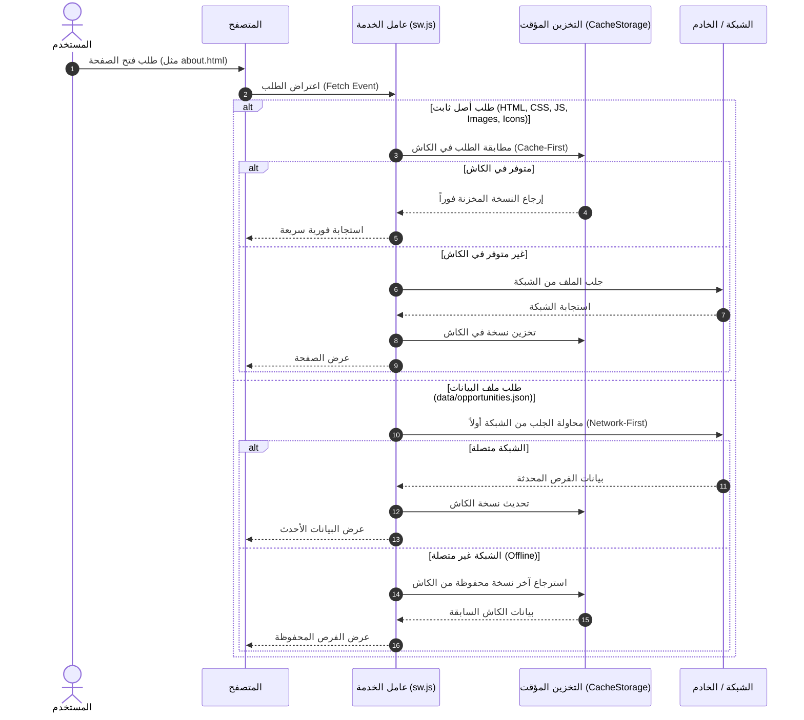

# معمارية النظام البرمجية | Opportunities Portal Architecture

**المشروع:** بوابة الفرص (Opportunities Portal)  
**البرنامج:** LLM4Yemen — Cohort 1 (مسار هندسة البرمجيات بالوكلاء)  
**البيئة:** تطبيق ويب ثابت خفيف الوزن (Static Web Application)  
**منصة التطوير:** Google Antigravity  

---

## 1. الفلسفة المعمارية العامة (Architectural Philosophy)

صُممت **بوابة الفرص** وفق مبادئ معمارية موجهة خصيصًا لحل التحديات التقنية والبنية التحتية في اليمن (انقطاع الكهرباء، بطء وتذبذب شبكة الإنترنت، استهلاك البيانات، والاعتماد الواسع على الهواتف الذكية منخفضة إلى متوسطة الموارد):

1. **معمارية ثابتة خالية من السيرفر (Zero-Backend Static Architecture):**
   التطبيق ثابت بالكامل (Pure Static Client-Side Application). لا يتطلب خادم تطبيقات نشطًا أو قواعد بيانات سحابية مكلفة ومعقدة. يمكن استضافته بسرعة وأمان على أي خادم ثابت أو شبكة توصيل محتوى مثل **GitHub Pages**.
2. **انعدام التبعيات الخارجية وقت التشغيل (Zero Runtime Dependencies):**
   الاعتماد بنسبة 100% على **Vanilla JavaScript (ES6+)**، و**HTML5 الدلالية**، و**CSS3 الحديثة**. لا وجود لأطر عمل ثقيلة (React, Angular, Vue) ولا مكتبات مساعدة خارجية (jQuery, Lodash, Bootstrap, Tailwind CDN)، مما يقلل حجم التحميل الإجمالي إلى أدنى حد ويزيل نقاط الفشل الناتجة عن حجب الروابط الخارجية.
3. **الجاهزية للعمل دون اتصال أولاً (Offline-First Resiliency):**
   بفضل دمج عامل الخدمة (`Service Worker`) ونظام التخزين المحلي (`localStorage`)، يتحول التطبيق بعد الزيارة الأولى إلى تطبيق مستقل يعمل بكفاءة تامة دون اتصال بالشبكة.
4. **أمان معالجة البيانات وبناء DOM (Defensive DOM Architecture):**
   حظر استخدام `innerHTML` لحقن بيانات الفرص لمنع ثغرات XSS، وتطبيق فحص صارم للروابط لضمان استخدام بروتوكول HTTPS المشفر.

---

## 2. مخطط الطبقات المعمارية (Layered Architecture Diagram)

---

## 3. تفصيل وحدات ومكونات النظام (System Component Breakdown)

### أ. طبقة البيانات (Data Layer: `data/opportunities.json`)
- تمثل "مصدر الحقيقة الوحيد" (Single Source of Truth) لكافة الفرص في التطبيق.
- ملف JSON منظم وصارم يلتزم بنموذج البيانات الموثق في `docs/data-schema.md`.
- يخضع لفحص برمجي آلي صارم عبر `scripts/validate-data.js` يمنع نشر أي فرصة لا تحتوي على رابط رسمي ببروتوكول HTTPS، أو تاريخ تحقق بشري، أو تحوي مواعيد متناقضة بين القبول الجامعي والمنحة.

### ب. الوحدات الأساسية المشتركة (Core Modules)
1. **وحدة التدويل واللغات (`js/i18n.js`):**
   - تدير القاموس الثنائي (عربي / إنجليزي).
   - توفر دالة الترجمة `t(key, lang)` ودوال تبديل اللغة `switchLang(lang)`.
   - تعدل سمات عنصر الجذر `<html>` تلقائيًا:
     - العربية: `lang="ar"`, `dir="rtl"`.
     - الإنجليزية: `lang="en"`, `dir="ltr"`.
   - تبث حدثًا مخصصًا `CustomEvent('langchange')` لإشعار كافة الوحدات الأخرى لتحديث عناصرها فورًا.
2. **مؤشر الفأرة التفاعلي ذو التباين الذكي (`js/cursor.js`):**
   - مؤشر جمالي خفيف الوزن يتبع حركة الفأرة بسلاسة عبر معادلات الاستكمال الخطي (Linear Interpolation - Lerp).
   - يفحص لون السطح الواقع تحته آنيًا عبر دالة `isTargetBlue(el)`؛ يتحول تلقائيًا للنقطة البيضاء فوق الخلفيات الزرقاء الكحلية، وإلى النقطة الزرقاء فوق الأسطح الفاتحة والبطاقات البيضاء.
   - يتوقف ويلغي نفسه فورًا على الشاشات اللمسية والأجهزة التي تفضل تقليل الحركة (`prefers-reduced-motion`).
3. **وحدة خلفية الهيرو التفاعلية (`js/hero-fx.js`):**
   - ترسم شبكة جسيمات خفيفة على عنصر `<canvas>` داخل قسم الهيرو الأزرق، مما يضفي عمقًا بصريًا دون التأثير على أداء المتصفح.

### ج. وحدات الوظائف والميزات (Feature Modules)
1. **محرك الكتالوج والبحث والتصفية (`js/list.js`):**
   - يقوم بتحميل ومعالجة الفرص من `data/opportunities.json`.
   - يوفر بحثًا فوريًا ثنائي اللغة (مطابقة بدون حساسية لحالة الأحرف في العنوان، الجهة، الدولة، التخصصات، والوصف).
   - يدير فلاتر متعددة متزامنة (Faceted Multi-Filters):
     - نوع الفرصة (`type`).
     - تصنيف التخصص (`fields.category`).
     - الدولة الجغرافية (`country.code`).
     - المستوى الدراسي (`levels`).
     - أهلية الطلاب اليمنيين (`yemenEligibility`).
     - المواعيد العاجلة (التي تنتهي خلال 14 يومًا فأقل).
   - يبني البطاقات باستخدام دوال DOM الآمنة لتجنب ثغرات XSS.
2. **وحدة صفحة التفاصيل المستقلة (`js/detail.js`):**
   - تقرأ معرّف الفرصة من استعلام الرابط (`window.location.search` عبر `URLSearchParams`).
   - تسترجع كائن الفرصة المطابق وتبني محتويات الصفحة (الشروط، التغطية المالية، مسار التقديم، مواعيد القبول، ورابط المصدر الرسمي).
   - تحسب الفارق الزمني والعداد التنازلي المباشر للفرص ذات المواعيد المحددة (`fixed`).
   - تعرض تنبيهًا بارزًا ومخصصًا للفرص التي تعتمد مواعيدها على البرنامج الأكاديمي (`course-dependent`) مانعة إظهار أي عداد مضلل.
3. **محرك المفضلة المحلية (`js/favorites.js`):**
   - يخزن مصفوفة معرفات الفرص المفضلة في `localStorage` تحت المفتاح `op-favorites`.
   - محمي بدوال `try...catch` للتعامل بأمان مع أوضاع التصفح الخفي (Private Browsing) والقيود المفروضة على الحصص التخزينية (QuotaExceededError).
   - يستمع لحدث التخزين في المتصفح `window.addEventListener('storage', ...)` لضمان تزامن المفضلة لحظيًا عبر كافة التبويبات المفتوحة في نفس المتصفح.

---

## 4. معمارية التخزين المؤقت وعامل الخدمة (Offline & Service Worker Lifecycle)

يعتمد التطبيق على ملف `sw.js` الذي يعمل في خلفية المتصفح وفق استراتيجية تخزين هجينة ومدروسة:

### إدارة دورة حياة الكاش (Cache Lifecycle Management):
- **اسم الكاش:** `opportunities-portal-v...` متضمنًا رقم الإصدار الدلالي.
- **تحديث الإصدار:** عند إصدار نسخة جديدة وتعديل رقم الكاش، تقوم دالة `activate` في `sw.js` بمسح كافة الكاشات القديمة تلقائيًا لمنع بقاء الملفات القديمة المعلقة لدى المستخدم.

---

## 5. معمارية التوافقية ثنائية الاتجاه وإمكانية الوصول (BiDi & Accessibility)

1. **الخصائص المنطقية في التنسيق (CSS Logical Properties):**
   - تم بناء ملف `css/main.css` باستخدام الخصائص المنطقية الحديثة بدلاً من الخصائص الاتجاهية الصلبة:
     - استخدام `margin-inline-start` و `margin-inline-end` بدلاً من `margin-left` و `margin-right`.
     - استخدام `padding-inline` و `inset-inline` لضمان انقلاب الهوامش والمحاذاة تلقائيًا عند تبديل اللغة.
2. **عزل النصوص المختلطة (BiDi Isolation):**
   - الأرقام والتواريخ والأكواد البرمجية وأسماء النطاقات والكلمات الإنجليزية داخل النصوص العربية يتم عزلها برمجيًا (عبر وسوم `<bdi>` أو خاصية `direction: ltr; display: inline-block`) لمنع تشوه علامات الترقيم والأقواس المعكوسة.
3. **التجاوب المطلق مع الشاشات الصغيرة (360px Mobile First):**
   - تم اختبار وضبط كل صفحة لتعمل بسلاسة تامة على شاشات بعرض **360 بكسل** (مثل أجهزة الأندرويد الاقتصادية الأكثر انتشارًا في اليمن) دون حدوث أي تمرير أفقي غير مرغوب (`overflow-x: hidden`).
4. **معايير الوصولية العالمية (WCAG 2.1 AA Compliance):**
   - تباين ألوان النصوص والعناصر يتجاوز نسبة 4.5:1 للمحتوى العادي و 3:1 للعناصر الكبيرة.
   - دعم كامل للملاحة عبر لوحة المفاتيح مع توفير رابط تخطي مباشر للمحتوى (`.skip-link`).
   - الإعلان عن تحديثات نتائج البحث عبر مناطق حية دلالية `aria-live="polite"`.

---

## 6. منهجية هندسة البرمجيات بالوكلاء المتوازيين (Agentic Architecture)

تم تطوير النظام عبر فريق وكلاء ذكي في بيئة **Google Antigravity** تحت إشراف بشري صارم، مع تقسيم دقيق لملكية الملفات لمنع أي تعارض أثناء البناء المتوازي:

| الوكيل (Agent) | نطاق المسؤولية البرمجية | الملفات المعتمدة حصريًا |
|---|---|---|
| **Agent A** | الكتالوج، البحث، الفلاتر، الفرز، عرض القائمة | `index.html` (قسم الكتالوج), `js/list.js` |
| **Agent B** | صفحة التفاصيل المستقلة، العدادات، محرك المفضلة | `detail.html`, `js/detail.js`, `js/favorites.js` |
| **Agent C** | صفحة عن المنصة، التوثيق المعماري، دليل التحقق، الدليل الطلابي | `about.html`, `README.md`, `docs/architecture.md`, `docs/verification-guide.md` |
| **Agent D** | التكامل النهائي، الكاش الشامل، توحيد التصميم والأداء | `css/main.css`, `js/i18n.js`, `sw.js`, `js/main.js` |

### ضمان النزاهة البشرية (Human-in-the-Loop Principle):
- يلتزم كل وكيل بإنتاج خطة عمل مفصلة (Implementation Plan) والحصول على اعتماد مالك المشروع البشري قبل الشروع في التعديل.
- يقتصر دور الوكلاء على تطوير الشيفرات والاختبارات، بينما يظل القرار النهائي لتوثيق الفرص واعتماد المخرجات قرارًا بشريًا أصيلاً.