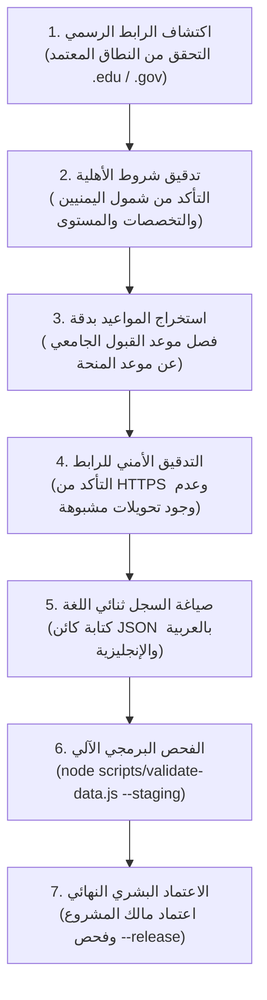

# دليل وبروتوكول التحقق اليدوي البشري من الفرص
## Opportunities Portal Human Verification & Data Integrity Guide

**المشروع:** بوابة الفرص (Opportunities Portal)  
**البرنامج:** LLM4Yemen — Cohort 1  
**المعيار:** الدليل القياسي لتوثيق وتدقيق واعتماد الفرص التعليمية  
**الهدف:** ضمان أعلى درجات الدقة والأمانة والموثوقية للطلاب اليمنيين  

---

## 1. فلسفة وأهداف التحقق البشري (Verification Philosophy)

تأسست **بوابة الفرص** لحل أزمة التشتت والمعلومات المضللة التي تعيق مسيرة الطلاب اليمنيين. يعاني الطالب اليمني في كثير من الأحيان من:
- إعلانات لمنح وهمية تهدف لجمع البيانات الشخصية أو النصب المالي.
- منشورات متداولة تعيد نشر شروط قديمة انتهت صلاحيتها أو أغلقت أبوابها.
- إعلانات لمنح عالمية يُفاجأ الطالب عند التقديم عليها باستثناء حاملي الجواز اليمني أو اشتراط إقامة في بلدان محددة.

لذا، فإن **القاعدة الأولى والنهائية في بوابة الفرص هي:**
> **"لا يُسمح للذكاء الاصطناعي بتأليف أي فرصة، أو تخمين أي موعد نهائي، أو توليد روابط وهمية. كل سجل يجب أن يمر عبر تحقق بشري يدوي كامل من المصدر الرسمي قبل إدراجه في الكتالوج النهائي."**

---

## 2. معايير اختيار وتدقيق المصادر (Primary Sourcing Guidelines)

### أ. المصادر المقبولة حصريًا (Acceptable Primary Sources)
1. **المواقع الرسمية للجامعات المعتمدة:**
   - النطاقات الأكاديمية الرسمية مثل `.edu` (الولايات المتحدة)، و`.ac.uk` (المملكة المتحدة)، والنطاقات الجامعية الوطنية المعتمدة في أوروبا وآسيا وأفريقيا.
   - مثال: `https://www.ox.ac.uk/...`، `https://www.cam.ac.uk/...`، `https://www.maastrichtuniversity.nl/...`.
2. **المواقع الحكومية والوزارية الرسمية:**
   - برامج المنح الحكومية المعتمدة الصادرة عن وزارات التعليم أو الخارجية في الدول المانحة (مثل برامج DAAD الألمانية، والمنحة التركية Türkiye Bursları، ومنحة الحكومة الهنغارية Stipendium Hungaricum).
   - النطاقات الحكومية الرسمية مثل `.gov` أو `.gov.tr` أو `.hu`.
3. **المنظمات الدولية والمؤسسات الوقفية المعترف بها:**
   - الوكالات التابعة للأمم المتحدة (UNESCO, UNHCR)، والمؤسسات الإنسانية والتعليمية الموثوقة (مثل مؤسسة عبد الله الغرير للتعليم، ومؤسسات القيادة المرموقة).
4. **منصات التعليم الإلكتروني الكبرى المعترف بها:**
   - البرامج المجانية ذات الشراكة المباشرة مع شركات التقنية العالمية (مثل برامج Coursera المدعومة، وIBM SkillsBuild).

### ب. المصادر الممنوعة منعًا باتًا (Strictly Prohibited Sources)
- ❌ المدونات العامة، والمنتديات، ومواقع تجميع المنح التجارية غير الرسمية.
- ❌ منشورات مجموعات وقنوات وسائل التواصل الاجتماعي (فيسبوك، تيليجرام، واتساب، لينكد إن) ما لم تتضمن رابطًا رسميًا للمصدر الأساسي ويتم فحص ذلك الرابط مباشرة.
- ❌ الروابط المختصرة (bit.ly, tinyurl) أو الروابط المضللة التي تمر عبر مواقع وسيطة للربح من الإعلانات.
- ❌ المخرجات التوليدية لنماذج الذكاء الاصطناعي (LLM Hallucinations) دون مراجعة الرابط المباشر وفحصه يدويًا.

---

## 3. تصنيف المواعيد النهائية والموعد المزدوج (Deadline Classification & Dual-Deadline Rules)

### أ. أنواع المواعيد النهائية (`deadlineType`)
| نوع الموعد (`deadlineType`) | الوصف والقواعد البرمجية | قيمة حقل `deadline` |
|---|---|---|
| `fixed` | موعد محدد ونهائي معلن رسميًا على موقع الجهة. | سلسلة تاريخ صالح `YYYY-MM-DD` |
| `ongoing` | فرصة مفتوحة ومستمرة طوال العام (مثل بعض الدورات التدريبية المفتوحة أو زمالات ما بعد الدكتوراه المستمرة). | يجب أن تكون `null` حصريًا |
| `course-dependent` | الموعد النهائي يختلف باختلاف البرنامج الأكاديمي أو القسم (مثل جامعة أكسفورد حيث تختلف المواعيد بين برامج الماجستير). | يجب أن تكون `null` حصريًا (يُحظر اختلاق تاريخ عام) |
| `periodic` | فرصة تتكرر سنويًا أو فصليًا في دورات منتظمة. | تاريخ الدورة الحالية `YYYY-MM-DD` أو `null` إذا لم تُعلن الدورة الجديدة بعد |
| `unknown` | فرصة رسمية لكن الموعد النهائي للدورة القادمة لم يُعلن رسميًا بعد. | يجب أن تكون `null` حصريًا |

### ب. قاعدة الموعد المزدوج الإلزامية (Dual-Deadline Distinction)
تشترط العديد من الجامعات العالمية المرموقة (مثل أكسفورد، وكامبريدج، وماستريخت) أن يستكمل الطالب طلب القبول الأكاديمي أولاً (`admissionDeadline`) ويحصل على القبول أو رقم الطلب قبل أن يصبح مؤهلاً لتقديم طلب المنحة المالية (`deadline`).

**القاعدة الحسابية الصارمة:**
$$\text{admissionDeadline} \le \text{deadline}$$
- يُمنع برمجيًا وإجرائيًا تسجيل `admissionDeadline` في تاريخ لاحق للموعد النهائي للمنحة `deadline`.
- في حال تطلب البرنامج قبولاً مسبقًا، يجب توثيق كلا التاريخين بوضوح في سجل الفرصة لتنبيه الطالب لعدم تفويت موعد الكلية الجامعية.

---

## 4. تصنيف أهلية الطلاب اليمنيين (Yemen Eligibility Taxonomy)

تخضع كل فرصة للتقييم الدقيق لتحديد مدى إمكانية استفادة الطلاب اليمنيين منها:

1. **مؤهل بالكامل (`eligible`):**
   - اليمن مذكورة صراحة ضمن قائمة الدول المؤهلة، أو أن الفرصة مفتوحة لكافة الجنسيات والدول النامية دون أي استثناء.
2. **مؤهل بشروط (`conditional`):**
   - الفرصة متاحة لليمنيين ولكنها تتطلب شروطًا خاصة، مثل:
     - اشتراط الحصول على قبول أكاديمي غير مشروط أولاً من جامعة شريكة.
     - اشتراط الإقامة الحالية في دولة لجوء محددة أو في بلد معين في الشرق الأوسط.
     - اشتراط خلفية بحثية أو رعاية من جهة عمل معتمدة.
3. **مقيد أو غير مؤهل (`restricted-or-ineligible`):**
   - البرنامج يستثني اليمن صراحة من قائمة المستفيدين، أو يتطلب ترشيحًا حكوميًا رسميًا غير متاح، أو يخضع لقيود تأشيرات وعقوبات تحظر التقديم المباشر. (تُستبعد هذه الفرص من العرض النشط إلا في حال التوثيق التحذيري).
4. **أهلية غير مؤكدة (`unconfirmed`):**
   - لم يتم إصدار قائمة الدول المؤهلة للدورة الجديدة رسميًا حتى تاريخ الفحص، وتخضع للمتابعة في تحديث قادم.

---

## 5. تصنيف التغطية المالية ونمط الحضور (Funding & Delivery Taxonomy)

### أ. التغطية المالية (`fundingCoverage`)
- `full-funding`: تمويل كامل يشمل الرسوم الدراسية 100%، ومخصصات معيشية شهرية، وتذاكر السفر والتأمين الصحي.
- `partial`: تمويل جزئي يغطي نسبة من الرسوم أو مساهمة مالية محددة.
- `tuition-waiver`: إعفاء كامل أو جزئي من الرسوم الدراسية فقط دون تغطية تكاليف السكن والمعيشة.
- `research-grant`: منحة مخصصة للإنفاق البحثي أو راتب شهري لمرحلة الدكتوراه وزمالات الأبحاث.
- `leadership-support`: تغطية تكاليف حضور برنامج قيادي أو مؤتمر تدريبي (إقامة وتنقلات وتدريب).

### ب. نمط الحضور (`deliveryMode`) والنطاق الجغرافي (`locationScope`)
- **نمط الحضور (`deliveryMode`):** يقتصر على `onsite` (حضوري في مقر المؤسسة)، `online` (عبر الإنترنت)، أو `hybrid` (مدمج).
- **النطاق الجغرافي (`country` و `locationScope`):**
  - تم فصل الدولة الجغرافية الحقيقية عن نمط الحضور.
  - **يُحظر استخدام كلمة ONLINE كرمز دولة.**
  - الفرص الافتراضية بالكامل أو متعددة الدول تأخذ `country: null` مع تحديد `locationScope: "global"` أو `"multi-country"`.

---

## 6. خطوات التحقق اليدوي البشري (Step-by-Step Verification Workflow)



### الخطوة 1: استخراج الرابط المباشر
- الدخول إلى الصفحة الرئيسية للمنحة على موقع الجامعة أو المنظمة.
- التأكد من أن الرابط مباشر للفرصة وليس رابطًا لصفحة تسجيل عامة أو محرك بحث داخلي.
- التأكد من أن بروتوكول الرابط يبدأ بـ `https://` المشفر.

### الخطوة 2: فحص دليل وإرشادات المتقدمين (Eligibility Guidelines)
- البحث عن قسم "Who can apply" أو "Eligibility criteria".
- التحقق من قائمة الدول المقبولة، والتأكد من إدراج اليمن أو انطباق صفة "International applicants" دون استثناءات في الملاحظات الجانبية.
- التحقق من المستوى الأكاديمي المطلوب (بكالوريوس، ماجستير، دكتوراه).

### الخطوة 3: استخراج التواريخ والمواعيد المزدوجة
- تدوين الموعد النهائي للتقديم.
- فحص ما إذا كانت الجامعة تطلب تقديم طلب القبول الأكاديمي للكلية أولاً، وتوثيق موعد القبول في حقل `admissionDeadline`.
- إذا كانت مواعيد التقديم تختلف بحسب القسم الأكاديمي، يتم تعيين `deadlineType: "course-dependent"` مع جعل `deadline: null`.

### الخطوة 4: كتابة السجل ثنائي اللغة وإضافته
- صياغة العنوان والجهة والوصف بدقة بالعربية الفصحى وباللغة الإنجليزية المتطابقة.
- تسجيل تاريخ الفحص الفعلي بصيغة `YYYY-MM-DD` في حقل `verificationDate`.

### الخطوة 5: الفحص البرمجي الآلي الشامل
قبل دمج أي فرصة جديدة في ملف الإنتاج، يتم تشغيل أدوات التحقق الآلية للتأكد من عدم وجود أي خطأ نحوي أو تاريخ وهمي:
```bash
# فحص ملف البيانات قيد التجهيز
node scripts/validate-data.js --staging

# فحص ملف الإنتاج النهائي للتأكد من المعايير الصارمة
node scripts/validate-data.js --release
```

---

## 7. قائمة التحقق قبل اعتماد أي سجل جديد (Pre-Release Checklist)

يجب أن يجيب مدقق البيانات البشري بـ **(نعم)** على جميع البنود التالية قبل اعتماد الفرصة:

- [ ] هل تم جلب الرابط من الموقع الرسمي للجهة المانحة مباشرة؟
- [ ] هل يبدأ الرابط بـ `https://` ويعمل بشكل مباشر وسريع؟
- [ ] هل تم التحقق يدويًا من أهلية الطلاب اليمنيين وتصنيفها بدقة؟
- [ ] هل التواريخ المسجلة تواريخ ميلادية حقيقية لا تحتوي على أخطاء في عدد أيام الشهور أو السنوات الكبيسة؟
- [ ] إذا وُجد موعد قبول جامعي مسبق (`admissionDeadline`)، هل تم التأكد أنه لا يتأخر عن موعد المنحة (`deadline`)؟
- [ ] إذا كانت المواعيد تعتمد على التخصصات، هل تم اختيار `course-dependent` مع جعل `deadline: null` دون اختلاق عداد زائف؟
- [ ] هل العنوان والوصف مكتوبان بلغة سليمة ومحايدة بالعربية والإنجليزية؟
- [ ] هل تم تسجيل تاريخ التحقق البشري الحقيقي اليوم في `verificationDate`؟
- [ ] هل يجتاز ملف البيانات فحص `node scripts/validate-data.js --release` بنجاح وبدون أي أخطاء؟

---

## 8. سياسة المراجعة الدورية وتصحيح البيانات (Maintenance & Retesting Policy)

1. **المراجعة الدورية الموسمية:**
   تخضع الفرص لمراجعة دورية قبل فتح دورات التقديم السنوية (أشهر سبتمبر، أكتوبر، ويناير) لتحديث التواريخ وروابط الأدلة الأكاديمية الجديدة.
2. **التعامل مع الروابط المنتهية أو المعطلة (Dead Links):**
   عند تغيير الجامعة لهيكلية روابطها، يتم البحث عن الرابط الرسمي الجديد وتحديثه مع تجديد حقل `verificationDate`. يُحظر استبدال الرابط برابط طرف ثالث تجاري.
3. **الشفافية في التصحيح:**
   في حال طرأ تعديل على شروط أهلية اليمنيين من قبل الجهة المانحة (مثل تعليق القبول أو فرض شروط جديدة)، يتم تحديث السجل فورًا مع إبراز التنبيه في وصف الفرصة لمنع تضليل المتقدمين.